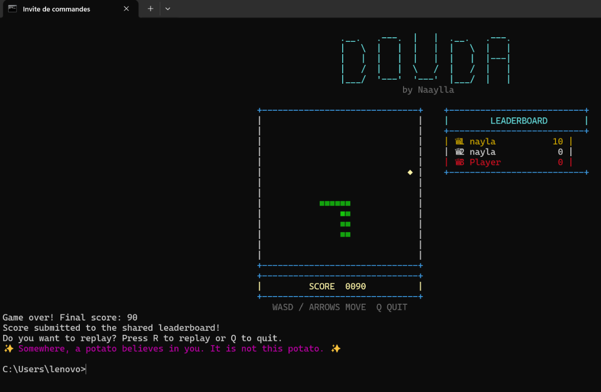

# Douda

Play Snake in your terminal.



```bash
pip install douda
douda
```

Move with **WASD** or the arrow keys. Press **Q** to quit during a run. After
game over, press **R** to replay or **Q** to exit.

Quit whenever you need. Douda will send you off with a motivational quote :)
